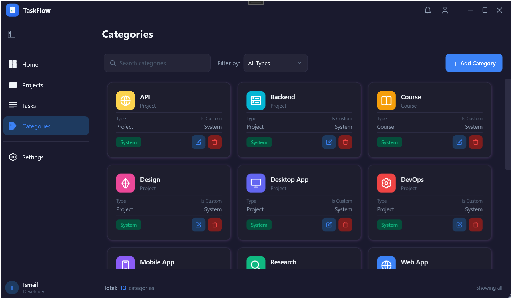
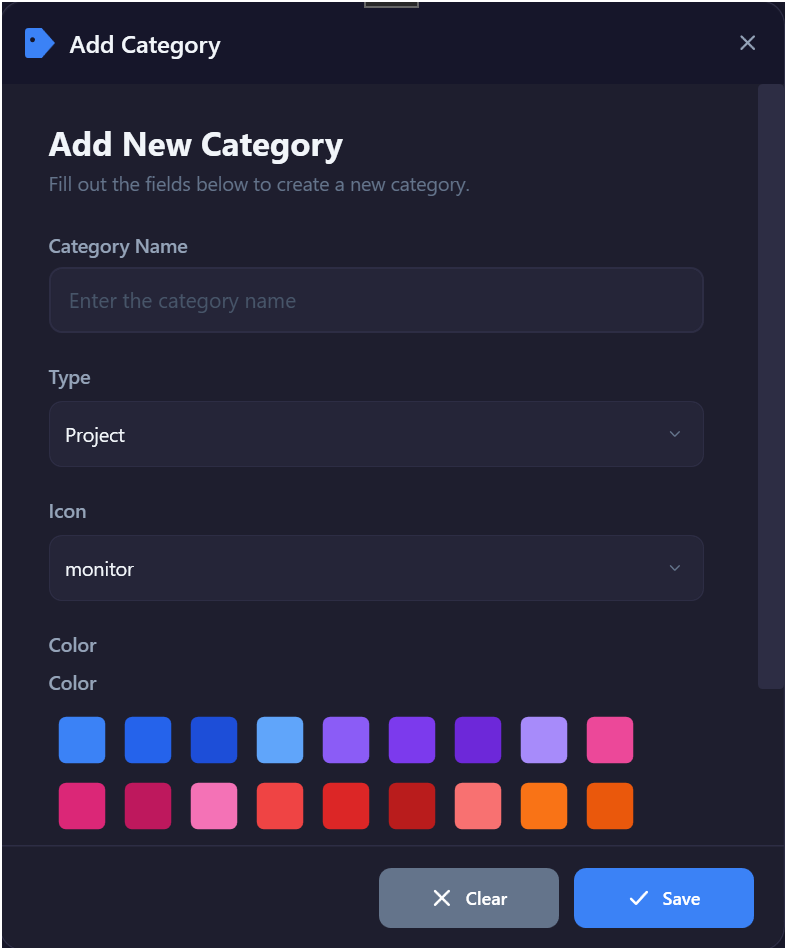
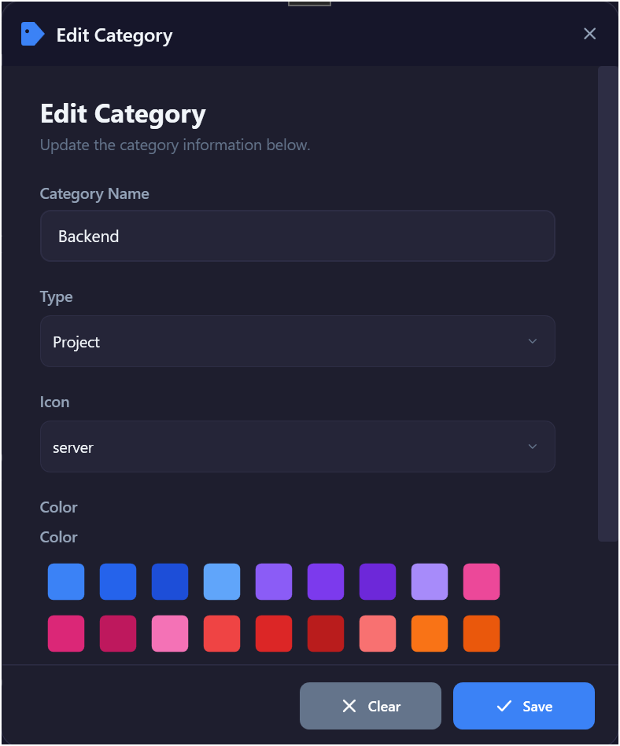
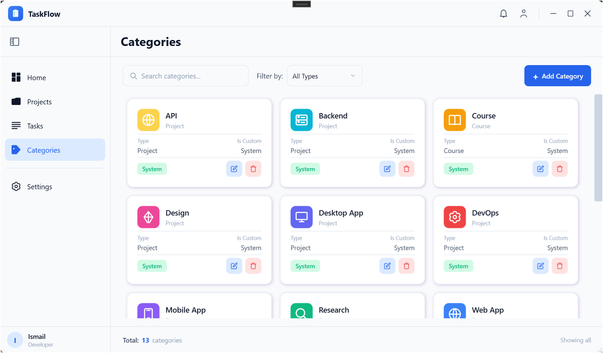
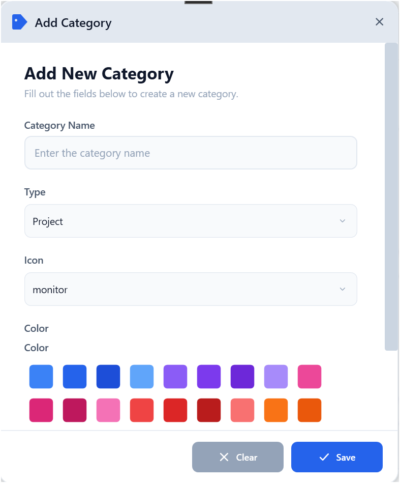
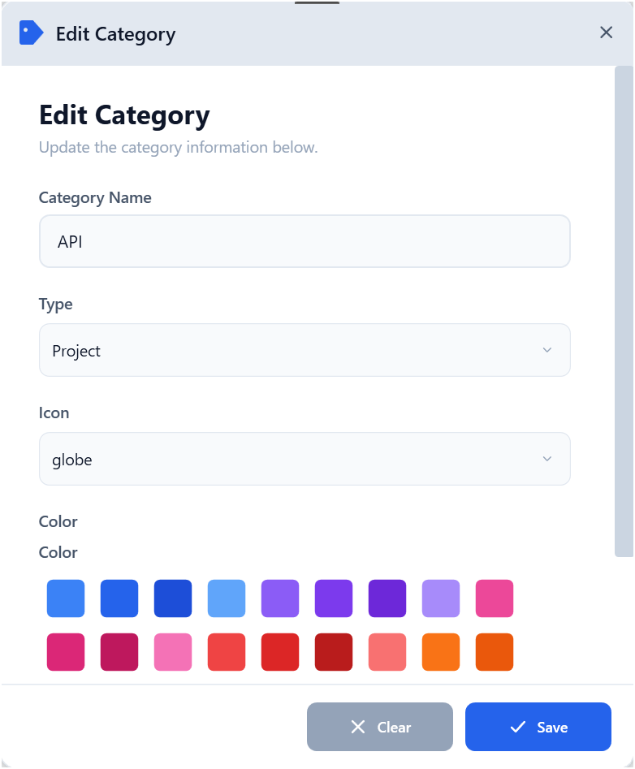
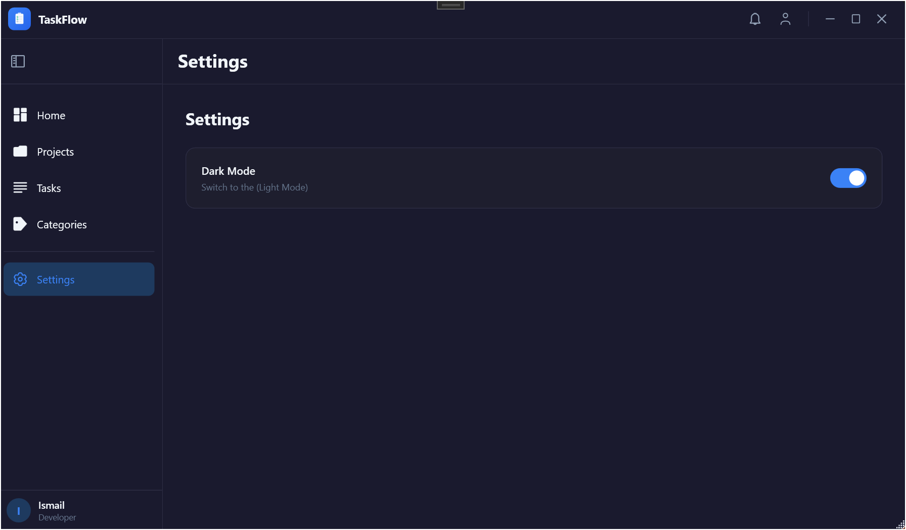
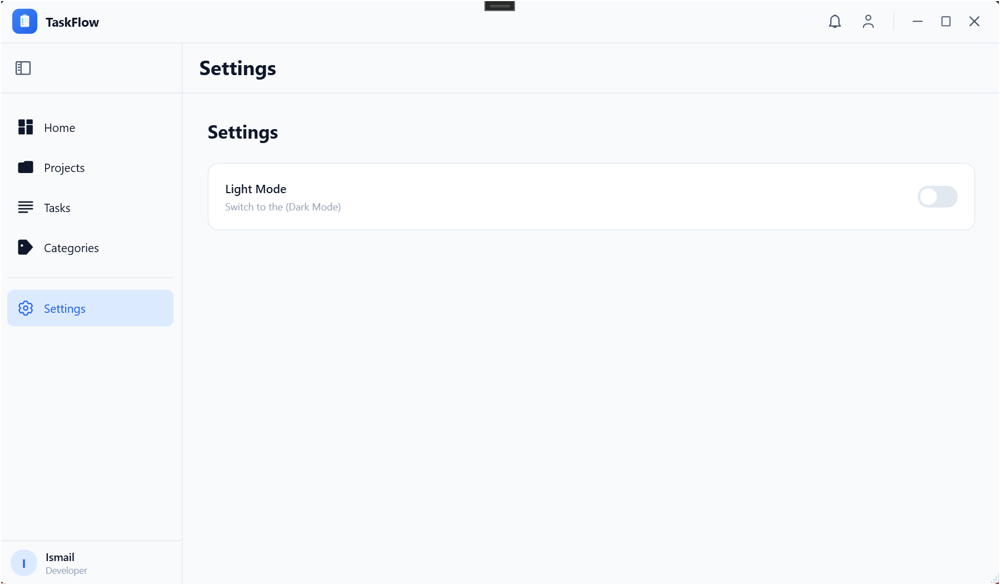

<h1 align="center">TaskFlow — Task & Project Manager</h1>
 
<p align="center">
  A modern WPF desktop app for managing projects, tasks and categories, with a built-in timer that logs the real time you work.
</p>
<p align="center">
  
  
  
  
</p>
> **Status: pre-release.** The core app works today. [Version 1.0.0](#-roadmap-to-v100) is planned once the roadmap below is done and the points rules are final.
 
**Highlights**
 
- ⏱️ A timer that saves the **real measured seconds** of every session, never rounded to match an estimate
- 🧭 Statuses are **managed by the app**, not typed into forms, so your data can't end up in an impossible state
- 🏆 A points system that rewards finished work and takes the points back if the work is reopened
- 🌗 Full dark / light theme
- 🧱 Clean 3-tier architecture: UI → Service → Repository → SQL Server
---
 
## 📸 Screenshots
 
### 🗂️ Categories — Dark
<p>
  
</p>
<p>
  
  
</p>
### 🗂️ Categories — Light
<p>
  
</p>
<p>
  
  
</p>
### ⚙️ Settings — Dark & Light
<p>
  
  
</p>
<!--
  More screenshots to add (same folder pattern as above), then uncomment:
  ### 📁 Projects
  <p>
    
    
  </p>
  ### 📋 Project details
  <p>
    
    
  </p>
  ### ✅ Tasks
  <p>
    
    
  </p>
  ### ⏱️ Timer
  <p>
    
    
  </p>
-->
 
---
 
## ✨ Features
 
### ✅ Categories
- View all categories in a responsive card grid
- Search and filter by name and type
- Add / Edit category (name, type, icon, color)
- Delete with smart validation:
  - Built-in categories cannot be deleted
  - Categories in use by projects cannot be deleted
### ✅ Projects
- Responsive card grid with search, filters (priority, status, category) and paging
- Add / Edit / Delete (completed projects, projects with active tasks and projects with completed tasks cannot be deleted)
- **Project details page:** task list with a play button on every task, progress, task counters, points earned with a points log, and time logged per task
- **Status is managed by the app** (see [Status rules](#-status-rules)):
  - *Mark as Done* is blocked while tasks are Todo or In Progress and tells you how many are left; it also needs at least one completed task
  - *Pause / Resume* and *Archive / Restore* from the details page; Restore brings back the status the project had before it was archived
  - A completed project becomes Active again when a task is added to it or a finished task is continued, and its completion bonus is taken back
### ✅ Archives
- Archived projects live in their own page (the Projects page in archive mode: same search, filters and paging)
- Back from a project's details returns to the page you came from, with the right menu highlight
### ✅ Tasks
- Responsive card grid with search, filters (priority, status, project) and paging
- An **estimate is required** when creating a task (more than 0 minutes)
- After creation the estimate is read-only: more time can only be added through *Add Extra Time*
- Status is managed by the app; the edit form only changes information
- Completed tasks and tasks that have timer sessions cannot be deleted
### ✅ Timer
- Start / Pause / Stop on a dedicated timer page for every task
- Remaining time is always *estimate − time already logged*, so stopping and resuming never adds or loses seconds
- Today's sessions and past sessions are listed on the page, with a live card for the running one
- The running session keeps counting while you browse other pages. A pulsing dot on the Tasks menu item shows it is active, and closing the app saves it
- When time runs out you choose between **Mark as Done** and **Add Extra Time**
- **Mark as Done** early at any moment. A task finished early shows *Completed early* and offers **Continue**, which reopens it without adding minutes and resumes from the logged seconds
- Sound effects when the timer starts and when time is up
### ✅ Points & activity
- See [Points](#-points) below
- Minutes tracked and tasks completed are logged per day
### ✅ Settings
- Toggle dark / light mode (remembered between launches)
### 🚧 Dashboard
- Activity overview, refreshed every time you open it
---
 
## 📏 Status rules
 
| Item    | Transition            | Triggered by                                              |
|---------|-----------------------|-----------------------------------------------------------|
| Task    | Todo → In Progress    | First timer start                                         |
| Task    | In Progress → Done    | *Mark as Done*, or the "time's up" dialog                 |
| Task    | Done → In Progress    | *Continue* (time left) or *Add Extra Time* (no time left) |
| Project | Active → Completed    | *Mark as Done* (blocked while tasks are open)             |
| Project | Completed → Active    | A task is added, or a finished task is reopened           |
| Project | Active ↔ Paused       | *Pause / Resume*                                          |
| Project | Any ↔ Archived        | *Archive / Restore* (Restore returns the previous status) |
 
The edit forms never change a status, and the checks live in the stored procedures, so they hold no matter where an action starts.
 
---
 
## 🏆 Points
 
| Event                                           | Points                                              |
|-------------------------------------------------|-----------------------------------------------------|
| Complete a task                                 | Earned once, based on the task's priority           |
| Complete a project                              | A completion bonus, based on the project's priority |
| Reopen a task (*Continue* / *Add Extra Time*)   | The task's points are taken back                    |
| Reopen a project (add a task, continue a task)  | The project's completion bonus is taken back        |
| Complete the work again                         | The points are earned again                         |
 
Points always match the current state of your work, so completing, reopening and completing again never counts twice. Reopening a task also removes it from the day it was completed in the daily log.
 
---
 
## 🧭 Navigation
 
```
Sidebar:  Home · Projects · Archives · Tasks · Categories · Settings
          (collapsible, with tooltips when collapsed)
 
Projects ── project card ──▶ Project details ── ▶ on a task ──▶ Timer
Tasks    ── task card ──────────────────────────────────────────▶ Timer
```
 
Detail pages have a **back button** (top left). From a project's details it returns to the page you opened it from (Projects or Archives).
 
---
 
## 🏗️ Architecture
 
```
TaskManager/
├── Repository/          # Data access layer (DAL): ADO.NET + stored procedures
├── Service/             # Business logic layer (BLL)
└── TaskManagerUI/       # WPF presentation layer
```
 
**Flow:** UI → Service → Repository → SQL Server (Docker in CI / SQL Server Express locally)
 
All database access goes through stored procedures. The rules that protect your data (status transitions, completion guards, points) live in the Service layer and in the stored procedures, so a form can never change a status by itself.
 
### Tech stack
 
| Layer        | Technology                                     |
|--------------|------------------------------------------------|
| UI           | WPF (.NET 8, Windows)                          |
| UI libraries | FontAwesome.Sharp (icons), NAudio (timer sounds) |
| Business     | C# Class Library (.NET 8)                      |
| Data Access  | C# Class Library + stored procedures           |
| Timer        | `Stopwatch` (real elapsed time) + `DispatcherTimer` (UI pulse) |
| Database     | SQL Server Express (local) / Docker (CI)       |
| CI           | GitHub Actions (Ubuntu + SQL Server container) |
 
---
 
## 🚀 Getting started
 
### Prerequisites
- Windows 10/11
- .NET SDK 9.0.200 or newer (the solution uses the `.slnx` format; the projects target .NET 8)
- SQL Server Express (for example `localhost\SQLEXPRESS01`)
- Visual Studio with `.slnx` support, or the .NET CLI
### Database
1. Create a database in SQL Server (the examples use `TaskManagerDb`)
2. Run the scripts in `Database/` in SSMS to create the tables and stored procedures
3. Tell the app where the database is with two environment variables:
```powershell
[System.Environment]::SetEnvironmentVariable("DB_SERVER", "localhost\SQLEXPRESS01", "User")
[System.Environment]::SetEnvironmentVariable("DB_NAME",   "TaskManagerDb", "User")
```
 
### Run
```bash
git clone https://github.com/benrisma133/TaskManager.git
cd TaskManager
dotnet build
```
 
Then open `TaskManagerUI` as the startup project in Visual Studio and run.
 
<!--
  Uncomment at the 1.0.0 release:
  ### Download
  Grab the latest build from the [Releases](https://github.com/benrisma133/TaskManager/releases) page.
-->
 
---
 
## 🗺️ Roadmap to v1.0.0
 
Everything below is tracked in the [issue list](https://github.com/benrisma133/TaskManager/issues). Items are ticked when they are merged.
 
### Foundations
- [ ] [#79](https://github.com/benrisma133/TaskManager/issues/79) Store statuses and priorities as `tinyint` mapped to C# enums instead of strings
- [ ] [#80](https://github.com/benrisma133/TaskManager/issues/80) Replace raw error strings with numeric error codes and data-layer enums
- [ ] [#116](https://github.com/benrisma133/TaskManager/issues/116) Unit test project for the business logic layer
- [ ] [#115](https://github.com/benrisma133/TaskManager/issues/115) SQLite provider as a fallback to SQL Server Express
- [ ] [#117](https://github.com/benrisma133/TaskManager/issues/117) ASP.NET Core Web API exposing the business logic layer
### Accounts & teams
- [ ] [#84](https://github.com/benrisma133/TaskManager/issues/84) People and Users tables with data-access and business-logic layers
- [ ] [#85](https://github.com/benrisma133/TaskManager/issues/85) Add / Edit User form
- [ ] [#86](https://github.com/benrisma133/TaskManager/issues/86) Users page with a Cards / List switcher for authorized roles
- [ ] [#87](https://github.com/benrisma133/TaskManager/issues/87) Extended profile page with profile details and links
- [ ] [#88](https://github.com/benrisma133/TaskManager/issues/88) Secure login and registration with password hashing
- [ ] [#89](https://github.com/benrisma133/TaskManager/issues/89) Change password from the profile page
- [ ] [#81](https://github.com/benrisma133/TaskManager/issues/81) Profile button with an initials, icon or custom-image avatar
- [ ] [#90](https://github.com/benrisma133/TaskManager/issues/90) Team rooms with room-level admin invitations and membership controls
### Subtasks, tags & planning
- [ ] [#94](https://github.com/benrisma133/TaskManager/issues/94) SubTasks tables with data-access and business-logic layers
- [ ] [#95](https://github.com/benrisma133/TaskManager/issues/95) Collapsible subtask checklist with a progress bar in the task details
- [ ] [#96](https://github.com/benrisma133/TaskManager/issues/96) Subtask progress (n/total) on task cards
- [ ] [#97](https://github.com/benrisma133/TaskManager/issues/97) Drag-and-drop reordering of subtasks
- [ ] [#98](https://github.com/benrisma133/TaskManager/issues/98) Tags and task-tags tables with data-access and business-logic layers
- [ ] [#99](https://github.com/benrisma133/TaskManager/issues/99) Chip input with autocomplete to assign tags in the task form
- [ ] [#100](https://github.com/benrisma133/TaskManager/issues/100) Multi-select tag filtering across projects and tasks
- [ ] [#109](https://github.com/benrisma133/TaskManager/issues/109) Drag-and-drop reordering and prioritization in card view
- [ ] [#107](https://github.com/benrisma133/TaskManager/issues/107) Recurring tasks (daily, weekly, custom schedules)
### Views, search & customization
- [ ] [#82](https://github.com/benrisma133/TaskManager/issues/82) Unified view switcher (Cards, Detailed List, Compact List) across Projects, Tasks, Categories and Archives
- [ ] [#110](https://github.com/benrisma133/TaskManager/issues/110) Global search across projects, tasks, categories and tags
- [ ] [#111](https://github.com/benrisma133/TaskManager/issues/111) Keyboard shortcuts for new task, start / stop timer and navigation
- [ ] [#112](https://github.com/benrisma133/TaskManager/issues/112) `Ctrl+K` command palette for quick actions and navigation
- [ ] [#113](https://github.com/benrisma133/TaskManager/issues/113) Customizable accent colors beyond dark / light
### Timer & productivity
- [ ] [#104](https://github.com/benrisma133/TaskManager/issues/104) Pomodoro mode with configurable work and break intervals
- [ ] [#105](https://github.com/benrisma133/TaskManager/issues/105) Auto-pause the timer when the user is idle
- [ ] [#108](https://github.com/benrisma133/TaskManager/issues/108) Due-date reminders as Windows toast notifications
- [ ] [#106](https://github.com/benrisma133/TaskManager/issues/106) Weekly / monthly time reports per project and category, with CSV export
### Import, backup & recovery
- [ ] [#83](https://github.com/benrisma133/TaskManager/issues/83) Trash for projects and tasks: soft delete with cascade rules, restore and purge
- [ ] [#114](https://github.com/benrisma133/TaskManager/issues/114) JSON export / import for full backup and restore
- [ ] [#101](https://github.com/benrisma133/TaskManager/issues/101) Markup parser to bulk-create projects, tasks, subtasks and tags from text
- [ ] [#102](https://github.com/benrisma133/TaskManager/issues/102) Import-from-text screen with a live preview before committing
- [ ] [#103](https://github.com/benrisma133/TaskManager/issues/103) Generate the import markup from natural language through an LLM API
### Before tagging 1.0.0
- [ ] Final decision on the [points rules](#-points)
- [ ] Screenshots for Projects, Tasks and the Timer
- [ ] Tag `v1.0.0` and publish the release
---
 
## 🤝 Contributing
 
`main` is protected: CI must pass before merging. Work is issue-first:
 
1. Pick or open an issue (labels: `enhancement`, `refactor`, `bug`)
2. Create a branch for it, for example `feat/78-timer-continue`
3. Use conventional commits: `feat(scope): ...`, `fix(scope): ...`, `refactor(scope): ...`, `docs: ...`
4. Open a pull request that closes the issue with `Closes #<number>`
---
 
## 📄 License
 
MIT